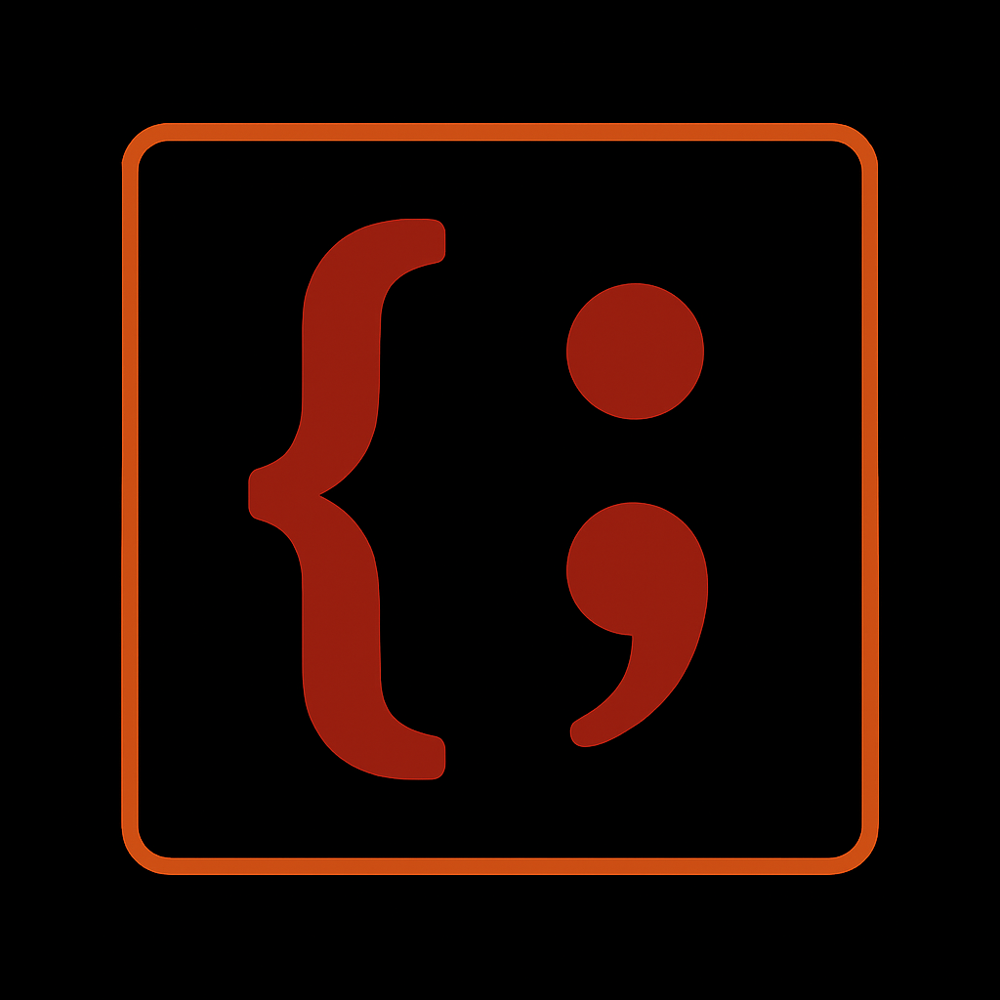

[Join Our Discord!](https://discord.gg/h7e55TPGEf)
# Mida
## Mida Music Programming Language
One of the main challenges in teaching a language model to make music is the lack of proper tools for expressing musical ideas in text. Mida is a notation language designed to address that gap. Mida offers a more expressive, readable, and flexible alternative to ABC notation and RAW MIDI.

While it's possible to generate musical patches using LLMs with programming languages like Faust, ChucK, Humdrum, and others, none of these systems provide what LLMs really need: A completely text-based solution for representing a full-length, fully produced song.

Our hope is that by sharing this language, more people start to get interested in teaching LLMs how to generate music purely from text. Please check out the README below if you're interested in learning about Mida! Thank you!
## What The ^*~> Is Mida?
Mida is a musical language designed to be a fully drop-in replacement for MIDI, not a backend for it. Unlike ABC notation, Mida supports drums, lyrics, and multitracked composition. Let's begin learning how to write Mida.

## Mida Basics: The Audicle

```mida
*C4 E4 G4*
```  


This is an **Audicle.** It's the basic building block of everything in Mida. In Mida, an Audicle is delimited by asterisks, and the information inside will be played on a quantized 16th note grid, no matter what, so in this Audicle, what you see here are three sixteenth notes, they are played one after the other. To add sustains and rests, we **simply add a period or a hyphen for each 16th sustain or 16th note rest** we want to add, and to make notes trigger polyphonically, we connect them with a tilde. To keep things well organized, we can use pipes to look like measure lines, but these will be ignored by our parser. Comments are done with double pipes outside Audicles, and multi-line comments are end-capped with a pipe and a greater-than symbol. Notes must have an octave and a pitch, and optionally an accidental with `#` or `b`


## Mida Basics: Sustains, Rests, Polyphony, Accidentals, and Decoration.
```mida
*C#4~E4~G#4 - - - | . . . .* || Cmaj 4th Octave Quarter Note + Quarter Note Rest |>
```
Next we will cover multitracking, lyrics, drums, loops, and more; but first, I feel as though it would be worth mentioning how the above Audicle would be printed. Mida prescribes a specific way that Audicles be printed known as the Audicle Log. Essentially, the composition is played where each 16th note event gets its own line. This makes it possible to debug music and align tracks without playing them aloud.


## Mida Basics: Chaining Audicles + The Audicle Log


As an example, I'll connect two Audicles with a tilde, which means they will start at the same time, then I'll show what the log output would look like.

```mida
*C#4~E4~G#4 - - - | . . . .*~*F#1~F#2 - - - | - - - -*
```

### Output:


```mida
C#4~E4~G#4 F#1~F#2

- -

- -

- -

. -

. -

. -

. -
```

In essence, the Audicle Log is your primary debugging tool, aside from your ears, for validating multitrack compositions. 

## Mida Basics: The Blawc

Using chained Audicles is useful for simpler compositions, but sometimes you need more power and complexity. The second way to do multitrack compositions in Mida is called a block. However, to avoid confusion with the common term, we refer to it as a *blawc.* To start a blawc, type this operator.

```
`~# 
```
The contents of the block are delimited by single quotes, like so: Each Audicle will start at the same time, just like chaining an Audicle, but without needing to use the tilde operator to link them manually. 

```
`~#
'
*C#4~E4~G#4 - - - | . . . .*
*F#1~F#2 - - - | - - - -*
'
```
Since they don't need to be connected by tildes, Mida blawcs open the door for non-local Audicles to have synchronous start times. This makes it much easier to manage layered compositions without having to keep everything in one chain. 
The output would be exactly the same as the chained Audicle example.

## Mida Basics: The Lyricle

Lyricles are lyrical Audicles. They get delimited by double quotes instead of asterisks, and show lyric information instead of note information, but the same rules apply. 

```
"Hello - - | World . . Of~Mida . ." ||  "Hello" plays for 3 16th notes. "World" plays for 1 16th note then rests for 2. "Of~Mida" is connected by a tilde which means both words are to be performed in that single 16th note. |>
```
## Mida Basics: Loops
It's often desirable while writing Mida to want to loop things. Mida makes this easy to do by simply wrapping your Audicle in question in a pair of curly braces, and putting a number before the brace opens to denote the number of times it loops. 
```
4 {*Bb3 - . | D3~F3 . . | D3~F3 . . *} || Loops the audicle four times |>
```
Loops work for any kind of Audicle, and can also be nested.
```
4 {"Hi - . | You . . | There . . "
4 {"I'm - - Here! - ."} } || Inner Loop Plays 4 Times For Each Outer Loop, Making the inner loop play for a total of 16 times  |>
```
## Intermediate Mida: Type Set Bunkers

**Type Set** is Mida's system for drum notation. Type Set notation uses special symbols to denote rhythmic events, and uses parentheses as delimiters; and is on an 8th note grid instead of a 16th note grid.
**The direction that the note is facing determines the swing**

```
Standard Hit      *|   or   |*
Accented Hit      ^|   or   |^
Ghost Note        v|   or   |v
Flam              /|   or   |/
Drag              *|,  or  ,|*
Double Stroke    **|   or   |**
Rest               _
Roll               {}
```

For Rolls, triplet, quintuplets, etc; Curly braces indicate rhythmic events that will happen in a single 8th note
```
({*| *| *|}) || Triplet 8th Notes |>
```
### Full Patterns
To actually delimit type set, we use parentheses and call it a **Bunker.** Here is an example of a simple four on the floor beat. Instruments are inferred, not explicitly denoted. 
```
(*| _ ^| _ *| _ ^| _)
```
A Simple swung "hi-hat" pattern that uses a **Roll.** Inside type set's parentheses "Bunkers," curly braces act as rolls, not loops, squeezing multiple hits into one 8th note event.
```
(*| {|* *|})
```


## Intermediate Mida: Polymorphism
The third way to do multi-track compositions in Mida is with the following operators: 

The Assignment Operator
```
^*~> 
```
The Call Operator

```
<~*^
```
The **Assignment** and **Call** operators are two frequently used operators, and can act as a Swiss-Army knife depending on the context. In this section we'll learn how to use them for basic multitrack compositions without a Blawc or a Tilde.
```
myAssignment ^*~> *C4 - - - Bb3 - - .*
myAssignment <~*^
```
Name an Audicle with ```^*~>```, then call it with ```<~*^```. This lets you sync Audicles without tildes or blawcs.
```
myOverloadedCHORD ^*~> *C#4~E4~G#4 - - - | . . . .*
myOverloadedCHORD ^*~> *F#1~F#2 - - - | - - - -*
myOverloadedCHORD <~*^
```
Assigning both Audicles overloads the name with both instead of overwriting. We can even achieve true polymorphism and overload the same name with different types of audicles. 
```
myPolymorphic ^*~> *C#4~E4~G#4 - - - | . . . .*
myPolymorphic ^*~> "Hello! - - - | - - - -"
myPolymorphic ^*~> (|* _ ^| _)
myPolymorphic <~*^
```
## Advanced Mida: Classical Concurrency
Inspired by classical concurrency primitives like barriers and joins, Mida introduces a clean symbolic solution in the Fence Operator. The ||| operator is used to block a return until multiple required symbols have been emitted. This allows coordination of symbolic events without the need for threading, scheduling, or manual dependency tracking.
### The Fence Operator: `|||`
In Mida, the fence operator is used like so:
```
d str "Chef"(
  $f chop @ (^| ^| ^|) ^*~> chopped,
  $f salad @ *F5 - - - | - - - - * ^*~> salad_done
)

return {chopped ||| salad_done}

Chef(chopped, salad_done)
```
In this example, "Chef" is a function which takes two $f classed functions as arguments. Each $f contains a musical sequence that resolves to a symbol using ```^*~>```. The function will only return once both chopped and salad_done have been resolved. The ||| operator ensures this happens deterministically.

This provides a minimal mechanism for synchronization across symbolic layers, allowing one function’s output to wait on the completion of multiple events. The system does not use clocks or timers—resolution is entirely symbolic.
